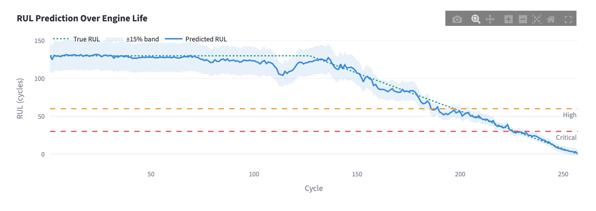
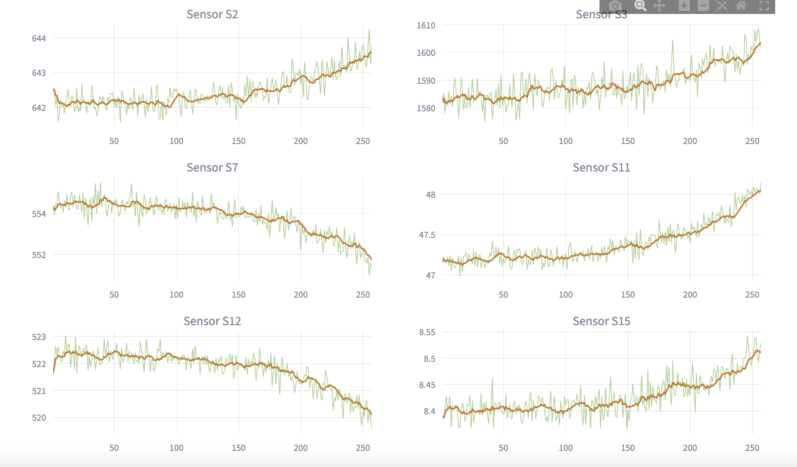

# PrognosticAI: Turbofan Engine Remaining Useful Life Prediction

[](https://github.com/BinuShefieldShifani/PrognosticAI/actions/workflows/ci.yml)

**Predictive maintenance pipeline for turbofan engines, from raw sensor data to maintenance work orders.**
Built on NASA C-MAPSS FD001 · XGBoost (GPU/CPU) · MLflow · Dagster · GitHub Actions · LangGraph · Local LLM (Ollama) · Elasticsearch (BM25 + kNN) · FastAPI · Docker

> **Result:** test RMSE 12.6 cycles (MAE 9.4) and NASA score 243 on the FD001 test set. Every training run is tracked in MLflow, the pipeline runs as Dagster assets with data-quality checks, and CI fails the build if accuracy regresses.
>
> **Serving:** the champion model runs behind a FastAPI service in Docker. CI builds the image, serves a freshly trained model and checks that the container returns the same predictions as the model run directly in Python.
>
> **Retrieval:** hybrid Elasticsearch search (BM25 + dense kNN, fused with RRF) finds the right maintenance procedure in the top 2 for 98% of 48 labelled queries, up from 81% with the original keyword matcher (MRR 0.809 to 0.955).

---

## What It Does

A turbofan engine reports 21 sensor readings every flight cycle (takeoff, cruise, landing). Over time, components like the High Pressure Compressor degrade: blade erosion increases tip clearance, efficiency drops, and eventually the engine fails.

PrognosticAI answers one question: **how many cycles until this engine needs maintenance?**

The prediction feeds a five-node LangGraph agent. Up to four nodes run for each engine, depending on whether it is degraded or healthy:

```
[Sensor Analyst]        ← finds which sensors are degrading (z-score anomaly detection)
       ↓
[RUL Estimator]         ← XGBoost model predicts Remaining Useful Life in cycles
       ↓
    (conditional)
       ├── degraded → [Failure Diagnosis]     ← LLM classifies the failure mode from sensor patterns
       │                     ↓
       │              [Work Order Generator]  ← LLM writes a structured MRO work order
       │
       └── healthy  → [Routine Advisory]      ← LLM writes a monitoring recommendation
```

If the LLM is unavailable, sensor analysis and RUL prediction still work. Only the diagnosis, work order and advisory text are affected.

## Screenshots

| RUL prediction (engine 54, held out from training) | Sensor trends |
|---|---|
|  |  |


---

## Dataset: NASA C-MAPSS FD001

| Property | Value |
|---|---|
| Source | NASA Prognostics Center of Excellence (public, free) |
| Sub-dataset | FD001: one operating condition, one fault mode (HPC degradation) |
| Training engines | 100 (run to failure) |
| Test engines | 100 (cut off at a random point, true RUL given) |
| Sensors | 21 per cycle (14 informative, 7 near-constant in FD001) |
| Format | Space-separated, 26 columns, no header |

```bash
python download_data.py
```

Original source: [NASA PCoE Data Set Repository](https://www.nasa.gov/intelligent-systems-division/discovery-and-systems-health/pcoe/pcoe-data-set-repository/) (Turbofan Engine Degradation Simulation).

---

## Architecture

```
prognosticai/
├── config.py                    ← thresholds, sensor lists, env-overridable paths and settings
├── download_data.py             ← fetches NASA C-MAPSS FD001
├── data_processor.py            ← loading, validation, RUL labelling, feature engineering
├── model_trainer.py             ← XGBoost training and evaluation, MLflow tracking, CLI
├── lstm_model.py                ← PyTorch LSTM network and sequence windows
├── lstm_trainer.py              ← LSTM challenger training on the same split, CLI
├── rul_predictor.py             ← packaged MLflow models: raw sensor cycles in, RUL out
├── registry.py                  ← model registry, champion/challenger promotion rules
├── promote.py                   ← promotion CLI
├── run_pipeline.py              ← whole pipeline in one command (used by CI and Kaggle)
├── report.py                    ← model comparison report from the registry
├── serve.py                     ← FastAPI service for the champion model
├── export_model.py              ← copies the champion out of the registry for the container
├── serve_smoke.py               ← end-to-end check of a running API on real engines
├── Dockerfile                   ← API image (model mounted at run time, not baked in)
├── pipelines/definitions.py     ← Dagster assets, data-quality checks, weekly schedule
├── knowledge_base.py            ← ATA chapter maintenance procedures (MRO-001 to MRO-006)
├── procedure_search.py          ← picks the retriever (keyword default, Elasticsearch optional)
├── es_retriever.py              ← Elasticsearch BM25, dense kNN and hybrid (RRF) search
├── embeddings.py                ← all-MiniLM-L6-v2 on ONNX Runtime (no PyTorch)
├── retrieval_eval.py            ← retrieval metrics: Hit@k, MRR, nDCG, by query type
├── eval/procedure_queries.jsonl ← 48 labelled retrieval queries
├── agent_graph.py               ← LangGraph agent (5 nodes, conditional routing)
├── app.py                       ← Streamlit dashboard
├── tests/                       ← pytest suite on synthetic C-MAPSS-format data
├── notebooks/kaggle_train.ipynb ← calls the scripts on a Kaggle GPU, no logic in the notebook
├── docs/                        ← screenshots
└── .github/workflows/ci.yml     ← lint, tests, real-data training, retrieval eval, API container
```

---

## Model Performance on FD001

Measured on the official test set (100 engines, last observed cycle), CPU run, seed 42:

| Metric | Result |
|---|---|
| Test RMSE | **12.6 cycles** |
| Test MAE | **9.4 cycles** |
| NASA score S | **243** |
| Mean error for engines with under 30 cycles left | +0.9 cycles |

Across five validation splits, test RMSE stayed between 12.4 and 12.9 and the NASA score between 238 and 270. A Kaggle GPU run gives the same range (12.4 to 12.5).

**Interpretation:** the typical error is about 9 cycles (MAE). RMSE is higher because it weights large misses more, which is what matters for maintenance planning.

**NASA score S** penalises late predictions (predicting more remaining life than the engine actually has, so maintenance comes too late) more than early ones. Lower is better.

Published FD001 results vary a lot depending on how the test labels and RUL cap are handled, so this README only reports numbers reproduced from this repo. Every number above comes from an MLflow run anyone can repeat.

### How the model got here

| Version | Test RMSE | NASA S | What changed |
|---|---|---|---|
| v3 | 18.5 | 641 | Rolling mean/std over 5 to 15 cycles, depth 8, row-level validation split |
| v4 | 18.4 | 690 | Engine-level validation split (same accuracy, honest validation, 20x faster) |
| v5 | **12.6** | **243** | Sensor trend (slope) features over 10 to 80 cycles, longer rolling windows, depth 5 |

**v4: validation leakage.** v3 shuffled rows before the train/validation split, so neighbouring cycles of the same engine ended up on both sides. Validation RMSE came out at 6.4 while test RMSE was 18.5. Splitting by engine (`GroupShuffleSplit`) fixed the validation estimate.

**v5: the model could not see how fast an engine was degrading.** With only 5 to 15 cycle windows, engines close to failure looked healthier than they were. For engines with under 30 cycles left, v4 predicted on average 7.9 cycles too much remaining life, which is the dangerous direction. Adding the slope of each sensor over the last 10, 30, 50 and 80 cycles brought that error down to +0.9 cycles.

Feature and model choices were made with 5-fold engine-level cross-validation on the training set only. The test set was used once, after choosing:

| Variant (5-fold engine CV) | CV RMSE |
|---|---|
| v4 features | 19.9 |
| + rolling windows up to 30 cycles | 17.9 |
| + slopes over 10, 20 cycles | 17.1 |
| + slope over 30 cycles | 15.3 |
| + slopes over 10, 30, 50, 80 cycles, depth 5 | **11.6** |
| EWM smoothing, or RUL cap 125 | no gain, not used |

Validation RMSE in the training log (about 8.5) is lower than test RMSE. Validation scores every cycle of the held-out engines, including the long healthy stretch that is easy to predict. The test set scores one cut-off point per engine.

---

## Setup

Requires Python 3.10 or newer. Use a virtual environment.

```bash
# 1. Create and activate a virtual environment
python3 -m venv venv
source venv/bin/activate          # Windows: venv\Scripts\activate

# 2. Install dependencies
pip install -r requirements.txt

# 3. Download data (about 2 MB)
python download_data.py

# 4. Train the model (about 15 s on CPU, logs the run to MLflow)
python model_trainer.py

# 5. Launch the dashboard
streamlit run app.py
```

Training options: `--device cpu|cuda|auto`, `--register` (add the model to the MLflow registry), `--no-mlflow`, `--fail-above-rmse 15`.

---

## Experiment Tracking (MLflow)

Each training run logs its parameters, metrics (validation and test RMSE, MAE, NASA score, best iteration or epoch, training time), the validation curve, per-engine test predictions and the packaged model. Runs are tagged with `model_type` (`xgboost` or `lstm`), git SHA and runner (local, CI or Kaggle). `--register` adds the model to the registry (see below).

```bash
python -m mlflow ui --backend-store-uri sqlite:///mlflow.db
```

Then open http://localhost:5000.

---

## Packaged Model

Every training run produces one self-contained MLflow model (`rul_predictor.py`). It bundles the
feature spec, the fitted scaler and the XGBoost model, so a caller sends raw sensor cycles and gets
RUL back. Before this, the model and scaler were two separate files and every caller rebuilt the
features itself, which meant a retrained model could be loaded next to an old scaler without any error.

```python
from rul_predictor import load_predictor
from data_processor import load_raw

predictor = load_predictor()                     # registry champion, or the local copy in models/rul_predictor
# or: mlflow.pyfunc.load_model("runs:/<run_id>/model")
raw = load_raw("test")
predictor.predict(raw[raw["unit"] == 3])
#  unit  last_cycle  history_cycles  short_history   rul   rul_lower  rul_upper
#     3         126             126          False  55.5        47.1       63.8
```

- **Input:** one row per cycle with `unit`, `cycle` and the 14 informative sensors. Extra columns are ignored.
  Missing sensors, nulls and gaps in the cycle sequence are rejected with a clear error.
- **Output:** one row per engine, predicted at its last observed cycle. Pass `params={"all_cycles": True}`
  for one row per cycle (used by the dashboard's trend chart).
- **Feature spec travels with the model.** Changing windows or sensors in `config.py` later does not change
  what an already trained model computes. A test checks this.
- **Short histories are flagged.** The longest slope window is 80 cycles. Engines with less history still get a
  prediction, but `short_history` is set. On the FD001 test set this covers 23 of 100 engines, and their RMSE
  is higher (17.0 vs 10.9). Part of that is because these engines are early in life and have high true RUL.
- The packaged model reproduces the training metrics exactly from raw data (test RMSE 12.56).

---

## LSTM Challenger and Model Registry

**Why train an LSTM at all?** XGBoost works from 183 hand-built features. The LSTM (`lstm_model.py`) only sees
the last 30 cycles of the 14 sensors and learns the pattern itself. If it wins, the feature engineering was
leaving signal on the table. If it loses, that is measured evidence for keeping the interpretable model.

Both models are trained on the **same engine-level split and seed** (a test checks the validation engines
match), packaged with the same contract, and logged to the same MLflow experiment.

**Registry.** There is one registered model, `prognosticai-rul`, for every architecture:

- each `--register` run adds a version tagged with its metrics and moves the alias `challenger-<model_type>`
- `promote.py` moves the `champion` alias; the agent and dashboard load `models:/prognosticai-rul@champion`
  (falling back to the local XGBoost package when no registry is available)

**Promotion rules** (`registry.py`):

1. A version must pass its test-RMSE gate (15 for XGBoost, 18 for the LSTM). The test set is a floor here, not a ranking.
2. Candidates are ranked on **validation RMSE**. Picking the model on test RMSE would leak the test set into model selection.
3. A challenger has to beat the champion by at least 0.5 cycles, so run-to-run noise does not flip the champion.

```bash
python promote.py --dry-run     # see the decision without changing anything
python report.py                # reports/model_comparison.md + validation_curves.png
```

**Result on FD001 (CPU run):**

| model | val RMSE | test RMSE | NASA score | role |
|---|---|---|---|---|
| XGBoost (183 features) | 8.48 | 12.56 | 242.6 | champion |
| LSTM (2 × 64, 30-cycle window) | 12.05 | 14.75 | 420.7 | challenger, not promoted |

The XGBoost validation RMSE is optimistic: its settings were tuned with cross-validation on these training
engines, and both models early-stop on the validation engines. The test set agrees on the order, though,
and the gap (2.2 cycles) is well beyond the promotion margin. The LSTM here is untuned, so this result says
"engineered trend features beat a plain LSTM on FD001", not "XGBoost beats every sequence model".

---

## Serving API (FastAPI + Docker)

The champion is served over REST. The API loads whatever `PROGNOSTIC_MODEL_URI` points to: by default the registry champion (`models:/prognosticai-rul@champion`), in Docker a folder mounted at `/models/champion`. Because XGBoost and LSTM packages share one contract, the API does not care which architecture won.

| Endpoint | What it does |
|---|---|
| `GET /health` | 200 when a model is loaded, 503 when not, so it works as a readiness probe |
| `GET /model` | model type, registry version and its validation/test RMSE |
| `POST /predict` | raw sensor cycles in, RUL per engine out (or per cycle with `"all_cycles": true`) |
| `POST /reload` | loads the model again after a new champion is promoted (needs `X-Admin-Token` if `PROGNOSTIC_ADMIN_TOKEN` is set) |

Bad input gets a 422 that says what is wrong (a missing sensor, a gap in the cycle sequence, a non-numeric value) instead of a stack trace. Every prediction is logged with the model version, number of engines and latency, and the response carries `X-Model-Type` and `X-Model-Version` headers.

### Run it locally

```bash
python run_pipeline.py            # train both models and promote a champion (if not done yet)
uvicorn serve:app --port 8000     # then open http://localhost:8000/docs
python serve_smoke.py             # sends five FD001 test engines and checks the answers
```

### Run it in Docker

The registry stores absolute paths from the training machine, so the champion is first copied out of it into a plain folder. The model is mounted, not baked into the image, so promoting a new champion needs no rebuild.

```bash
python export_model.py                      # registry champion -> serving/champion
docker build -t prognosticai-api .          # add --build-arg WITH_TORCH=0 for a smaller, XGBoost-only image
docker run -p 8000:8000 -v "$PWD/serving/champion:/models/champion:ro" prognosticai-api
python serve_smoke.py --compare-local serving/champion
```

Example request:

```bash
curl -s localhost:8000/predict -H "Content-Type: application/json" -d '{"cycles": [
  {"unit": 3, "cycle": 1, "s2": 642.4, "s3": 1585.3, "...": "every sensor the model was trained on"},
  ...]}'
```

Measured once on FD001 (5 test engines, 410 cycles, a single CPU core): the XGBoost champion answered in about 280 ms and the LSTM challenger in about 45 ms, both identical to the same package run directly in Python. The XGBoost time is mostly feature engineering (183 rolling and slope features per cycle).

---

## Pipeline Orchestration (Dagster)

```
cmapss_raw_files ──(raw_data_is_valid, blocking)──┬──▶ xgboost_rul_model ──(xgboost_rmse_within_gate)──┐
                                                  └──▶ lstm_rul_model ─────(lstm_rmse_within_gate)─────┴──▶ champion_model
```

The data-quality check (schema, nulls, cycle continuity, label count) blocks training if the raw data is bad. Each model has an RMSE gate. `champion_model` runs the promotion rules above. The whole graph is scheduled to retrain weekly (Monday 03:00, Europe/Stockholm).

To run everything once from the command line, without the Dagster UI:

```bash
python run_pipeline.py --device cpu       # or cuda / auto
```

```bash
pip install -r requirements-dev.txt
python -m dagster dev
```

Then open http://localhost:3000. To run it once from the command line:

```bash
dagster asset materialize -m pipelines.definitions --select '*'
```

---

## Testing and CI

`pytest` runs the suite on small synthetic files in C-MAPSS format, so it is fast and works offline. It covers RUL labelling, feature engineering, a check that features never use future cycles, data validation, the engine-level split, the NASA score, MLflow logging and model reload, and the full Dagster graph including a failing gate. The Elasticsearch retrieval tests use a fake Elasticsearch here; the live ones run in their own CI job.

GitHub Actions runs on every push to `main` and on every pull request:

1. `ruff`, Dagster definition validation and `pytest` (including a 2-epoch LSTM and the promotion rules)
2. `run_pipeline.py` on the real FD001 data (CPU PyTorch, 15 LSTM epochs). The build fails if any gate fails. The comparison report appears in the job summary and the MLflow store is uploaded as a build artifact.
3. Procedure retrieval eval against a real Elasticsearch 8.15 service container. The build fails if hybrid retrieval scores below the keyword baseline.
4. API container: trains the XGBoost package on FD001, builds the Docker image, starts it with the model mounted, and runs `serve_smoke.py` against it. The build fails if the container's predictions differ from the same package run locally.

---

## GPU Training on Kaggle

`notebooks/kaggle_train.ipynb` contains no training code. It clones the repo, installs MLflow and Dagster, runs `pytest`, then `python run_pipeline.py --device cuda`, and prints `reports/model_comparison.md`. Set `BRANCH` in the second cell to test a feature branch before merging. In the notebook settings, set the accelerator to GPU and turn Internet on.

---

## LLM Backend (Ollama)

The agent uses a local LLM through Ollama, so no data leaves the machine:

```bash
docker run -d --gpus all -p 11434:11434 --name ollama ollama/ollama
docker exec -it ollama ollama pull gpt-oss:20b
```

The model name must match `OLLAMA_MODEL` in `config.py`.

---

## Maintenance Procedure Retrieval (Elasticsearch)

When an engine is degraded, the agent attaches the two most relevant maintenance procedures to the work order. The original retriever in `knowledge_base.py` counts shared words. It works when the LLM uses the same words as the procedure, and it fails quietly when it doesn't: with no word overlap every procedure scores zero, and it returns the HPC and HPT procedures simply because they come first in the list. That happens for one of the agent's own outputs, "General Engine Degradation".

The add-on indexes the procedures in Elasticsearch and ranks them three ways:

| Mode | How it ranks |
|---|---|
| `bm25` | `multi_match` over title, failure modes, ATA chapter, steps and parts, English analyzer |
| `dense` | kNN on a `dense_vector` field (all-MiniLM-L6-v2, 384 dims, cosine, HNSW) |
| `hybrid` | both lists fused with Reciprocal Rank Fusion (k = 60) |

The emergency rule is unchanged: below 15 cycles of RUL the shutdown procedure (MRO-006) goes first, by rule, not by ranking. It is filtered out of every search.

### Results

48 queries, written and labelled before any retriever was run (`eval/procedure_queries.jsonl`). Each has one correct procedure, and some have an acceptable second one for nDCG. Query types: the exact strings the diagnosis node produces, paraphrases, sensor-trend descriptions, procedure requests, and ATA/AMM references or part names.

| Retriever | Hit@1 | Hit@2 | MRR | nDCG@3 |
|---|---|---|---|---|
| keyword (original) | 0.71 | 0.81 | 0.809 | 0.808 |
| bm25 | 0.92 | 0.98 | 0.953 | 0.966 |
| dense | 0.90 | 0.94 | 0.933 | 0.932 |
| **hybrid** | **0.92** | **0.98** | **0.955** | **0.965** |

MRR by query type:

| Retriever | agent output (10) | paraphrase (14) | symptom (6) | procedure (10) | reference (8) |
|---|---|---|---|---|---|
| keyword | 0.925 | 0.780 | 1.000 | 0.665 | 0.754 |
| bm25 | 1.000 | 0.875 | 0.917 | 1.000 | 1.000 |
| dense | 0.950 | 0.964 | 1.000 | 1.000 | 0.723 |
| hybrid | 0.950 | 0.952 | 1.000 | 1.000 | 0.875 |

**What the numbers say.** BM25 and dense fail on different queries. Dense search can't match codes: it misses "ATA 72-30" and "AMM 72-10-05" because to an embedding model they are just numbers. BM25 misses paraphrases with no shared words, like "bird strike damaged the front of the engine". Hybrid is never the worst on any query type, which is why it is the default mode. On a corpus this small BM25 alone is almost as good overall, so the honest claim is robustness, not a big jump over BM25.

The one query hybrid still misses in the top 2 is "engine is shaking more than usual" (vibration, MRO-004): BM25 matches "engine" to the shop-visit procedure and pulls it up.

No settings were tuned on these queries. Field boosts, RRF k and the embedding model were fixed before the first run.

### Running it

```bash
pip install -r requirements-search.txt          # onnxruntime + tokenizers, only for dense/hybrid
python embeddings.py --download                 # all-MiniLM-L6-v2 ONNX, about 90 MB, once

docker run -d -p 9200:9200 -e discovery.type=single-node -e xpack.security.enabled=false \
  docker.elastic.co/elasticsearch/elasticsearch:8.15.3

python retrieval_eval.py --es-url http://localhost:9200     # prints both tables and every miss

# Use it in the agent (default stays keyword)
export PROGNOSTIC_RETRIEVER=elasticsearch
export PROGNOSTIC_ES_MODE=hybrid                # or bm25 / dense
streamlit run app.py
```

The index is created on first use and rebuilt automatically when a procedure or the embedding model changes (a fingerprint is stored in the index mapping). If Elasticsearch is down or times out, the agent falls back to keyword retrieval and says so in the reasoning log. For Elastic Cloud, set `PROGNOSTIC_ES_URL` and `PROGNOSTIC_ES_API_KEY`.

### CI

A third CI job starts Elasticsearch 8.15 as a service container, runs the live tests, then runs the eval and posts the tables in the job summary. It fails if hybrid MRR drops below the keyword baseline. The unit tests for this part use a fake Elasticsearch, so the main test job still runs offline.

---

## Key Engineering Decisions

**Why FD001?** One operating condition means no need to cluster or normalise by operating point. The signal is cleanest, which makes results easier to validate.

**Why piecewise RUL (cap at 130)?** Engines don't degrade steadily from new. They run healthy for most of their life, then degrade. The cap tells the model to focus on the last 130 cycles. This is the standard approach since Saxena et al. (2008).

**Why these 14 sensors?** In FD001, sensors s1, s5, s6, s10, s16, s18 and s19 barely change, so they carry no degradation signal and only add noise. This was checked with variance analysis and XGBoost feature importance.

**Why rolling and slope features?** A single sensor reading is noisy. Rolling mean and standard deviation over 5, 10, 20 and 30 cycles smooth it. The rolling slope over 10, 30, 50 and 80 cycles measures how fast each sensor is drifting. That is what separates an engine close to failure from one that has only just started to degrade. All features look backwards only, so no future data leaks into a prediction, and there is a test for this. 14 sensors x 13 features + cycle_norm = 183 features.

**Why do the slopes rank low in feature importance if they helped so much?** Most predictions are healthy engines, where the rolling means do the work. The slopes matter most for engines close to failure, which is exactly where the error dropped. Correlated features also share importance, so a single feature's score undersells it.

**Why Dagster over Airflow?** It installs with pip, runs locally with `dagster dev`, treats the data and the model as assets with built-in quality checks, and the whole graph can run inside pytest. That is what lets CI test the pipeline itself.

---

## Limitations

- FD001 only: one operating condition and one fault mode. FD002 to FD004 (multiple conditions and faults) are not tested yet.
- Simulated data, not real engine telemetry.
- The ±15% band shown around predictions is a fixed heuristic, not a calibrated uncertainty estimate.
- The maintenance knowledge base is illustrative, and the LLM-generated work orders have not been reviewed by maintenance engineers.
- The retrieval eval covers six procedures and 48 queries written by me. It shows how the retrievers behave and fail, but a real ATA manual with thousands of task cards is a different scale, where dense search and HNSW settings would matter more.

---

## References

- Saxena, A., Goebel, K., Simon, D., & Eklund, N. (2008). *Damage Propagation Modeling for Aircraft Engine Run-to-Failure Simulation.* PHM'08 Conference.
- [LangGraph documentation](https://langchain-ai.github.io/langgraph/)
- [MLflow documentation](https://mlflow.org/docs/latest/)
- [Dagster documentation](https://docs.dagster.io/)
