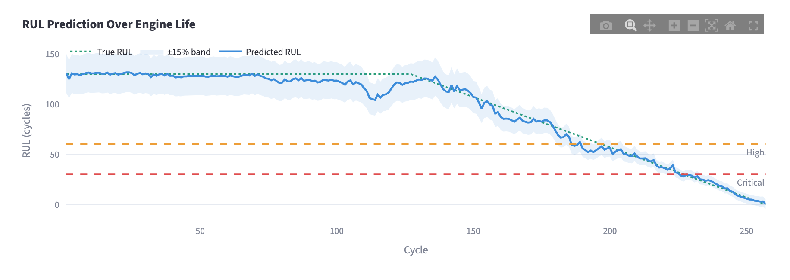
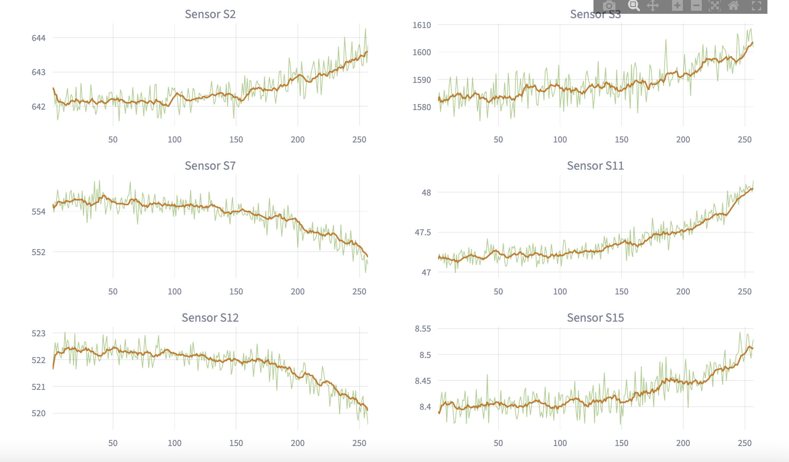
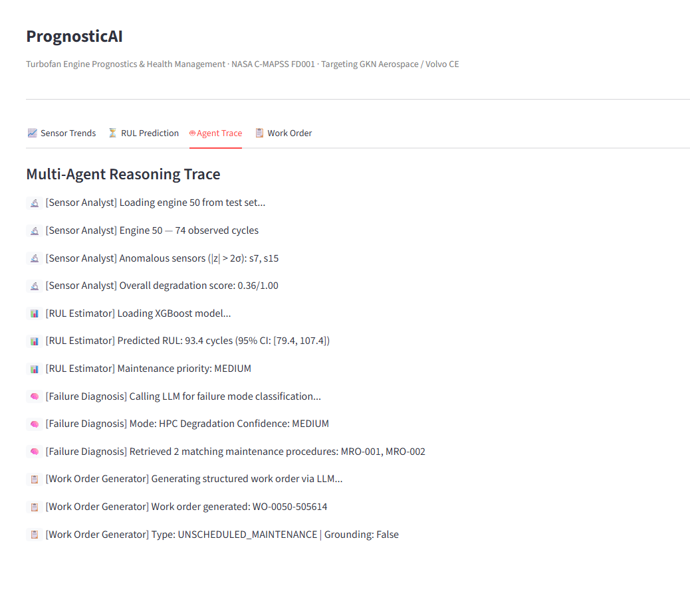
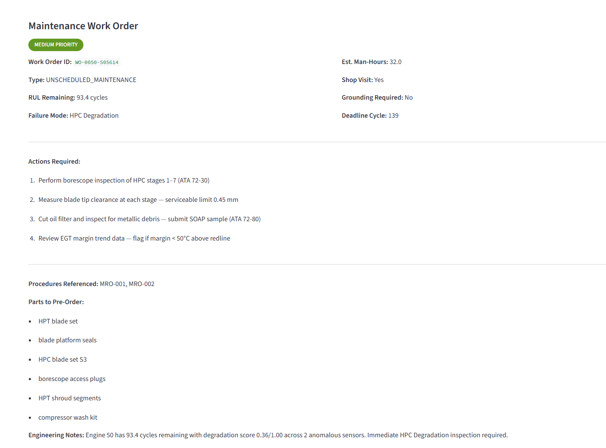

# PrognosticAI: Turbofan Engine Remaining Useful Life Prediction

[](https://github.com/BinuShefieldShifani/PrognosticAI/actions/workflows/ci.yml)

**Predictive maintenance pipeline for turbofan engines, from raw sensor data to maintenance work orders.**
Built on NASA C-MAPSS FD001 · XGBoost (GPU/CPU) · MLflow · Dagster · GitHub Actions · LangGraph · Local LLM (Ollama)

> **Result:** test RMSE 12.6 cycles (MAE 9.4) and NASA score 243 on the FD001 test set. Every training run is tracked in MLflow, the pipeline runs as Dagster assets with data-quality checks, and CI fails the build if accuracy regresses.

---

## What It Does

A turbofan engine reports 21 sensor readings every flight cycle (takeoff, cruise, landing). Over time, components like the High Pressure Compressor degrade: blade erosion increases tip clearance, efficiency drops, and eventually the engine fails.

PrognosticAI answers one question: **how many cycles until this engine needs maintenance?**

The prediction feeds a five-node LangGraph agent. Up to four nodes run for each engine, depending on whether it is degraded or healthy:

```
[Sensor Analyst]        ← finds which sensors are degrading (z-score anomaly detection)
       ↓
[RUL Estimator]         ← XGBoost model predicts Remaining Useful Life in cycles
       ↓
    (conditional)
       ├── degraded → [Failure Diagnosis]     ← LLM classifies the failure mode from sensor patterns
       │                     ↓
       │              [Work Order Generator]  ← LLM writes a structured MRO work order
       │
       └── healthy  → [Routine Advisory]      ← LLM writes a monitoring recommendation
```

If the LLM is unavailable, sensor analysis and RUL prediction still work. Only the diagnosis, work order and advisory text are affected.

## Screenshots

| RUL prediction (engine 54, held out from training) | Sensor trends |
|---|---|
|  |  |

| Agent trace | Work order |
|---|---|
|  |  |

---

## Dataset: NASA C-MAPSS FD001

| Property | Value |
|---|---|
| Source | NASA Prognostics Center of Excellence (public, free) |
| Sub-dataset | FD001: one operating condition, one fault mode (HPC degradation) |
| Training engines | 100 (run to failure) |
| Test engines | 100 (cut off at a random point, true RUL given) |
| Sensors | 21 per cycle (14 informative, 7 near-constant in FD001) |
| Format | Space-separated, 26 columns, no header |

```bash
python download_data.py
```

Original source: [NASA PCoE Data Set Repository](https://www.nasa.gov/intelligent-systems-division/discovery-and-systems-health/pcoe/pcoe-data-set-repository/) (Turbofan Engine Degradation Simulation).

---

## Architecture

```
prognosticai/
├── config.py                    ← thresholds, sensor lists, env-overridable paths and settings
├── download_data.py             ← fetches NASA C-MAPSS FD001
├── data_processor.py            ← loading, validation, RUL labelling, feature engineering
├── model_trainer.py             ← XGBoost training and evaluation, MLflow tracking, CLI
├── pipelines/definitions.py     ← Dagster assets, data-quality checks, weekly schedule
├── knowledge_base.py            ← ATA chapter maintenance procedures (MRO-001 to MRO-006)
├── agent_graph.py               ← LangGraph agent (5 nodes, conditional routing)
├── app.py                       ← Streamlit dashboard
├── tests/                       ← pytest suite on synthetic C-MAPSS-format data
├── notebooks/kaggle_train.ipynb ← GPU training run on Kaggle
├── docs/                        ← screenshots
└── .github/workflows/ci.yml     ← lint, tests, real-data training and RMSE gate
```

---

## Model Performance on FD001

Measured on the official test set (100 engines, last observed cycle), CPU run, seed 42:

| Metric | Result |
|---|---|
| Test RMSE | **12.6 cycles** |
| Test MAE | **9.4 cycles** |
| NASA score S | **243** |
| Mean error for engines with under 30 cycles left | +0.9 cycles |

Across five validation splits, test RMSE stayed between 12.4 and 12.9 and the NASA score between 238 and 270. A Kaggle GPU run gives the same range (12.4 to 12.5).

**Interpretation:** the typical error is about 9 cycles (MAE). RMSE is higher because it weights large misses more, which is what matters for maintenance planning.

**NASA score S** penalises late predictions (predicting more remaining life than the engine actually has, so maintenance comes too late) more than early ones. Lower is better.

Published FD001 results vary a lot depending on how the test labels and RUL cap are handled, so this README only reports numbers reproduced from this repo. Every number above comes from an MLflow run anyone can repeat.

### How the model got here

| Version | Test RMSE | NASA S | What changed |
|---|---|---|---|
| v3 | 18.5 | 641 | Rolling mean/std over 5 to 15 cycles, depth 8, row-level validation split |
| v4 | 18.4 | 690 | Engine-level validation split (same accuracy, honest validation, 20x faster) |
| v5 | **12.6** | **243** | Sensor trend (slope) features over 10 to 80 cycles, longer rolling windows, depth 5 |

**v4: validation leakage.** v3 shuffled rows before the train/validation split, so neighbouring cycles of the same engine ended up on both sides. Validation RMSE came out at 6.4 while test RMSE was 18.5. Splitting by engine (`GroupShuffleSplit`) fixed the validation estimate.

**v5: the model could not see how fast an engine was degrading.** With only 5 to 15 cycle windows, engines close to failure looked healthier than they were. For engines with under 30 cycles left, v4 predicted on average 7.9 cycles too much remaining life, which is the dangerous direction. Adding the slope of each sensor over the last 10, 30, 50 and 80 cycles brought that error down to +0.9 cycles.

Feature and model choices were made with 5-fold engine-level cross-validation on the training set only. The test set was used once, after choosing:

| Variant (5-fold engine CV) | CV RMSE |
|---|---|
| v4 features | 19.9 |
| + rolling windows up to 30 cycles | 17.9 |
| + slopes over 10, 20 cycles | 17.1 |
| + slope over 30 cycles | 15.3 |
| + slopes over 10, 30, 50, 80 cycles, depth 5 | **11.6** |
| EWM smoothing, or RUL cap 125 | no gain, not used |

Validation RMSE in the training log (about 8.5) is lower than test RMSE. Validation scores every cycle of the held-out engines, including the long healthy stretch that is easy to predict. The test set scores one cut-off point per engine.

---

## Setup

Requires Python 3.10 or newer. Use a virtual environment.

```bash
# 1. Create and activate a virtual environment
python3 -m venv venv
source venv/bin/activate          # Windows: venv\Scripts\activate

# 2. Install dependencies
pip install -r requirements.txt

# 3. Download data (about 2 MB)
python download_data.py

# 4. Train the model (about 15 s on CPU, logs the run to MLflow)
python model_trainer.py

# 5. Launch the dashboard
streamlit run app.py
```

Training options: `--device cpu|cuda|auto`, `--register` (add the model to the MLflow registry), `--no-mlflow`, `--fail-above-rmse 15`.

---

## Experiment Tracking (MLflow)

Each training run logs its parameters, metrics (validation and test RMSE, MAE, NASA score, best iteration, training time), the validation curve, feature importance, per-engine test predictions, the scaler and the model itself. `--register` adds the model to the registry as `prognosticai-rul-xgb`.

```bash
python -m mlflow ui --backend-store-uri sqlite:///mlflow.db
```

Then open http://localhost:5000.

---

## Pipeline Orchestration (Dagster)

```
cmapss_raw_files ──(raw_data_is_valid, blocking)──▶ rul_model ──(rmse_within_gate)
```

The data-quality check (schema, nulls, cycle continuity, label count) blocks training if the raw data is bad. The RMSE gate fails if test RMSE goes above 15 cycles. The whole graph is scheduled to retrain weekly (Monday 03:00, Europe/Stockholm).

```bash
pip install -r requirements-dev.txt
python -m dagster dev
```

Then open http://localhost:3000. To run it once from the command line:

```bash
dagster asset materialize -m pipelines.definitions --select '*'
```

---

## Testing and CI

`pytest` runs the suite on small synthetic files in C-MAPSS format, so it is fast and works offline. It covers RUL labelling, feature engineering, a check that features never use future cycles, data validation, the engine-level split, the NASA score, MLflow logging and model reload, and the full Dagster graph including a failing gate.

GitHub Actions runs on every push to `main` and on every pull request:

1. `ruff`, Dagster definition validation and `pytest`
2. Training on the real FD001 data (CPU). The build fails if test RMSE goes above 15. The MLflow run is uploaded as a build artifact and the metrics appear in the job summary.

---

## GPU Training on Kaggle

`notebooks/kaggle_train.ipynb` clones the repo, runs the tests, then runs the Dagster pipeline on a Kaggle GPU and shows the MLflow runs. In the notebook settings, set the accelerator to GPU and turn Internet on before running.

---

## LLM Backend (Ollama)

The agent uses a local LLM through Ollama, so no data leaves the machine:

```bash
docker run -d --gpus all -p 11434:11434 --name ollama ollama/ollama
docker exec -it ollama ollama pull gpt-oss:20b
```

The model name must match `OLLAMA_MODEL` in `config.py`.

---

## Key Engineering Decisions

**Why FD001?** One operating condition means no need to cluster or normalise by operating point. The signal is cleanest, which makes results easier to validate.

**Why piecewise RUL (cap at 130)?** Engines don't degrade steadily from new. They run healthy for most of their life, then degrade. The cap tells the model to focus on the last 130 cycles. This is the standard approach since Saxena et al. (2008).

**Why these 14 sensors?** In FD001, sensors s1, s5, s6, s10, s16, s18 and s19 barely change, so they carry no degradation signal and only add noise. This was checked with variance analysis and XGBoost feature importance.

**Why rolling and slope features?** A single sensor reading is noisy. Rolling mean and standard deviation over 5, 10, 20 and 30 cycles smooth it. The rolling slope over 10, 30, 50 and 80 cycles measures how fast each sensor is drifting. That is what separates an engine close to failure from one that has only just started to degrade. All features look backwards only, so no future data leaks into a prediction, and there is a test for this. 14 sensors x 13 features + cycle_norm = 183 features.

**Why do the slopes rank low in feature importance if they helped so much?** Most predictions are healthy engines, where the rolling means do the work. The slopes matter most for engines close to failure, which is exactly where the error dropped. Correlated features also share importance, so a single feature's score undersells it.

**Why Dagster over Airflow?** It installs with pip, runs locally with `dagster dev`, treats the data and the model as assets with built-in quality checks, and the whole graph can run inside pytest. That is what lets CI test the pipeline itself.

---

## Limitations

- FD001 only: one operating condition and one fault mode. FD002 to FD004 (multiple conditions and faults) are not tested yet.
- Simulated data, not real engine telemetry.
- The ±15% band shown around predictions is a fixed heuristic, not a calibrated uncertainty estimate.
- The maintenance knowledge base is illustrative, and the LLM-generated work orders have not been reviewed by maintenance engineers.

---

## References

- Saxena, A., Goebel, K., Simon, D., & Eklund, N. (2008). *Damage Propagation Modeling for Aircraft Engine Run-to-Failure Simulation.* PHM'08 Conference.
- [LangGraph documentation](https://langchain-ai.github.io/langgraph/)
- [MLflow documentation](https://mlflow.org/docs/latest/)
- [Dagster documentation](https://docs.dagster.io/)
